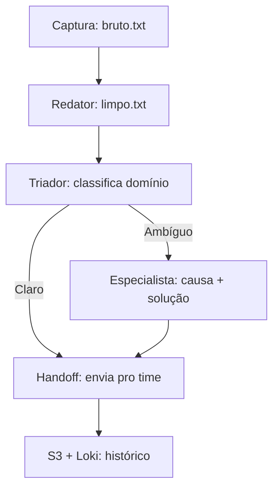

# Agent Architecture - Micro-agentes para Classificação de Incidentes

Arquitetura de micro-agentes independentes para processamento, classificação e handoff de incidentes técnicos.

## Agentes

| Agente | Responsabilidade | Role RBAC | Entrada | Saída |
|--------|------------------|-----------|---------|-------|
| **Redator** | Remove dados sensíveis (senhas, tokens, keytabs) | `redator` | `bruto.txt` | `limpo.txt` |
| **Triador** | Classifica domínio (Airflow, k8s, Hadoop, etc.) | `triador` | `limpo.txt` | Classificação + metadados (S3/DB) |
| **Especialista** | Análise profunda: causa raiz + solução (casos ambíguos) | `especialista` | Classificação ambígua | Análise detalhada |
| **Handoff** | Envia para times (Jira, Slack, Email) | `handoff` | Classificação + análise | Ticket/Notificação |

## Fluxo



## Stack

- **Linguagens**: Python 3.11+ (primary), Go 1.21+ (opcional para performance)
- **Mensageria**: Arquivos locais (dev) → S3 + Kafka (prod)
- **Observabilidade**: Loki (logs), Prometheus (metrics), Tempo (traces)
- **Deploy**: Kubernetes (k8s) com Kustomize + ArgoCD
- **CI/CD**: GitHub Actions
- **Segurança**: RBAC por agente, secrets via Vault/SealedSecrets

## Estrutura

```
.
├── agents/
│   ├── redator/
│   ├── triador/
│   ├── especialista/
│   └── handoff/
├── shared/           # Código compartilhado (schemas, clients, utils)
├── k8s/
│   ├── base/         # Manifests base
│   └── overlays/     # Overlays dev/prod
├── docs/adr/         # Architecture Decision Records
├── .github/workflows/# CI/CD pipelines
└── scripts/          # Scripts utilitários
```

## Quick Start

```bash
# Instalar dependências
make install

# Rodar testes
make test

# Build imagens
make build

# Deploy local (kind/k3d)
make deploy-dev
```

## Reuniões

- **Arquitetura**: Segundas 17h BR - Meet: https://meet.google.com/xyz-abc-def
- **Daily**: Dias úteis 9h BR - Slack huddle

## Licença

Proprietário - Uso interno apenas.