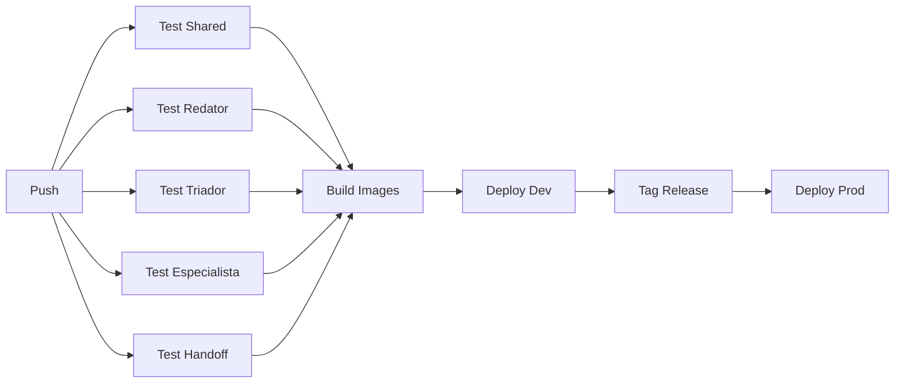

# Incident Pipeline

[](https://github.com/iamcflb/incident-pipeline/actions/workflows/ci-cd.yaml)
[](LICENSE)
[](https://www.python.org/downloads/)
[](https://kubernetes.io/)

> **Pipeline de processamento de incidentes técnicos** — Ingest → Sanitização → Classificação → Análise de Causa Raiz → Handoff (Jira/Slack/Email)

---

## 🎯 Visão Geral

Sistema de micro-agentes independentes para processamento automatizado de logs/erros técnicos:

```
┌─────────────┐    ┌─────────────┐    ┌─────────────┐    ┌─────────────┐    ┌─────────────┐
│   BRUTO     │───▶│  REDATOR    │───▶│  TRIADOR    │───▶│ESPECIALISTA │───▶│  HANDOFF    │
│  (logs/     │    │ (sanitiza   │    │ (classifica │    │ (causa raiz │    │ (Jira/Slack/│
│  erros)     │    │  senhas/    │    │  domínio,   │    │  + solução) │    │  Email)     │
│             │    │  tokens)    │    │  severidade)│    │             │    │             │
└─────────────┘    └─────────────┘    └─────────────┘    └─────────────┘    └─────────────┘
```

### Fluxo de Dados

| Etapa | Agente | Input | Output | Responsabilidade |
|-------|--------|-------|--------|------------------|
| 1 | **Redator** | `bruto*.txt` | `*_limpo.txt` + `.record.json` | Remove segredos (senhas, tokens, JWT, chaves AWS, URLs DB) |
| 2 | **Triador** | `*_limpo.txt` | `*_limpo.classificacao.json` | Classifica domínio (Airflow, K8s, Hadoop, Spark, Kafka, DB, Network, Security), severidade, ambiguidade |
| 3 | **Especialista** | `*_limpo.classificacao.json` (se ambíguo) | `*_limpo.classificacao.analise.json` | Causa raiz, solução sugerida, ações imediatas/preventivas, referências (runbooks) |
| 4 | **Handoff** | `*_limpo.classificacao.json` + análise | `*_limpo.classificacao.handoff.json` | Cria issue Jira, posta no Slack, envia Email/Teams |

---

## 🏗️ Arquitetura

### Micro-agentes (Deploy Independente)

| Agente | Linguagem | Port | Recursos (dev) | Recursos (prod) | Escala |
|--------|-----------|------|----------------|-----------------|--------|
| **Redator** | Python 3.11 | 8080 | 50m CPU / 64Mi RAM | 200m CPU / 256Mi RAM | HPA (CPU + queue depth) |
| **Triador** | Python 3.11 | 8080 | 50m CPU / 128Mi RAM | 200m CPU / 512Mi RAM | HPA + KEDA (Kafka) |
| **Especialista** | Python 3.11 | 8080 | 100m CPU / 256Mi RAM | 500m CPU / 1Gi RAM | HPA (limitado por custo LLM) |
| **Handoff** | Python 3.11 | 8080 | 50m CPU / 128Mi RAM | 200m CPU / 512Mi RAM | HPA + PriorityClass |

### Comunicação

- **Fase 1 (Dev/Staging)**: Arquivos em PVC compartilhado (`/data/in`, `/data/out`) + polling watchers
- **Fase 2 (Produção)**: S3 (objetos) + Kafka (eventos de coordenação)
- **Contrato**: Schemas Pydantic em `shared/schemas.py` (single source of truth)

### Storage

| Dado | Storage | Retenção |
|------|---------|----------|
| Arquivos brutos/processados | S3 (MinIO/CEPH/AWS) | 30d hot → 1y cold → delete |
| Logs estruturados | Loki | 90d |
| Metadados pipeline | PostgreSQL | 5y |

### Segurança

- **RBAC por agente**: ServiceAccount + Role + RoleBinding por agente
- **Secrets**: SealedSecrets (dev) / Vault CSI (prod)
- **Network Policies**: Isolamento entre agentes
- **Pod Security Standards**: non-root, read-only FS, drop ALL capabilities

---

## 🚀 Quick Start

### Pré-requisitos

- Python 3.11+
- Docker + Docker Compose
- kubectl + k3d/kind (para k8s local)
- kustomize

### Desenvolvimento Local

```bash
# 1. Clone e instale dependências
git clone git@github.com:iamcflb/incident-pipeline.git
cd incident-pipeline
make install

# 2. Rode testes
make test          # 67 testes unitários
make lint          # Ruff
make typecheck     # MyPy

# 3. Pipeline local (arquivos em /tmp)
make run-pipeline

# 4. Stack completa (MinIO + Loki + Prometheus + Grafana + agentes)
docker compose --profile agents up -d
```

### Deploy no Kubernetes (k3d)

```bash
# 1. Crie cluster local
k3d cluster create incident-pipeline --agents 2

# 2. Importe imagens
make docker-build
k3d image import agent-redator:dev agent-triador:dev agent-especialista:dev agent-handoff:dev -c incident-pipeline

# 3. Deploy dev
make deploy-dev

# 4. Teste pipeline
kubectl exec -n agent-system deploy/agent-redator -- bash -c '
  echo "ERROR - senha=teste123 token=abc456
  DAG exemplo_dag task task1 failed
  Scheduler heartbeat missed" > /data/in/bruto_teste.txt
'
sleep 15
kubectl exec -n agent-system deploy/agent-redator -- ls -la /data/out
```

### Testar com Seus Logs

```bash
# Envie seu log bruto
kubectl exec -n agent-system deploy/agent-redator -- bash -c '
  cat > /data/in/bruto_meu_log.txt << "EOF"
  SEU LOG AQUI
  senha=minhasenha123 token=abcxyz
  ERROR DAG failed...
  EOF
'

# Aguarde ~15s e veja resultado
sleep 15
kubectl exec -n agent-system deploy/agent-redator -- cat /data/out/bruto_meu_log_limpo.txt
kubectl exec -n agent-system deploy/agent-redator -- cat /data/out/bruto_meu_log_limpo.classificacao.json
kubectl exec -n agent-system deploy/agent-redator -- cat /data/out/bruto_meu_log_limpo.classificacao.analise.json
```

---

## 📦 Estrutura do Projeto

```
incident-pipeline/
├── agents/
│   ├── redator/           # Sanitização de segredos
│   │   ├── src/redator/
│   │   ├── tests/
│   │   ├── watcher.py     # Polling watcher (/data/in → /data/out)
│   │   ├── Dockerfile
│   │   └── pyproject.toml
│   ├── triador/           # Classificação de domínio
│   │   ├── src/triador/
│   │   ├── tests/
│   │   ├── watcher.py
│   │   ├── Dockerfile
│   │   └── pyproject.toml
│   ├── especialista/      # Análise causa raiz (mock/LLM)
│   │   ├── src/especialista/
│   │   ├── tests/
│   │   ├── watcher.py
│   │   ├── Dockerfile
│   │   └── pyproject.toml
│   └── handoff/           # Notificação Jira/Slack/Email
│       ├── src/handoff/
│       ├── tests/
│       ├── watcher.py
│       ├── Dockerfile
│       └── pyproject.toml
├── shared/                # Biblioteca comum
│   ├── src/agent_shared/
│   │   ├── schemas.py     # Pydantic models (contrato)
│   │   └── utils.py       # Redaction, logging, pipeline ID
│   ├── tests/
│   └── pyproject.toml
├── k8s/
│   ├── base/              # Manifests base
│   │   ├── namespace.yaml
│   │   ├── pvc.yaml
│   │   ├── rbac.yaml
│   │   ├── *-deployment.yaml
│   │   ├── config-secrets.yaml (kustomize generators)
│   │   └── kustomization.yaml
│   └── overlays/
│       ├── dev/           # 1 replica, recursos mínimos
│       └── prod/          # 3+ replicas, HPA, PriorityClass
├── docs/adr/              # Architecture Decision Records
│   ├── 001-microservicos-agentes-independentes.md
│   ├── 002-comunicacao-arquivos-s3-kafka.md
│   ├── 003-armazenamento-s3-loki-postgres.md
│   ├── 004-seguranca-rbac-secrets.md
│   └── 005-escalabilidade-hpa-keda.md
├── monitoring/
│   ├── prometheus.yml
│   └── grafana/
│       ├── datasources/
│       └── dashboards/
├── scripts/
│   └── watch_and_process.py  # Legacy async watcher
├── docker-compose.yml     # Stack local completa
├── Makefile               # Comandos unificados
└── .github/workflows/ci-cd.yaml
```

---

## ⚙️ Configuração

### Variáveis de Ambiente (por agente)

| Variável | Redator | Triador | Especialista | Handoff |
|----------|---------|---------|--------------|---------|
| `LOG_LEVEL` | ✅ | ✅ | ✅ | ✅ |
| `INPUT_PATH` | ✅ | ✅ | ✅ | ✅ |
| `OUTPUT_PATH` | ✅ | ✅ | ✅ | ✅ |
| `S3_BUCKET` | ✅ | ✅ | ✅ | ✅ |
| `LOKI_URL` | ✅ | ✅ | ✅ | ✅ |
| `MODELO_CLASSIFICACAO` | | ✅ | | |
| `THRESHOLD_CONFIANCA` | | ✅ | | |
| `USAR_LLM` | | | ✅ | |
| `MODELO_LLM` | | | ✅ | |
| `CANAIS` | | | | ✅ |
| `JIRA_PROJECT_KEY` | | | | ✅ |
| `SLACK_WEBHOOK_URL` (secret) | | | | ✅ |

### Secrets (k8s)

```yaml
# k8s/base/secrets.yaml (gerado via kustomize secretGenerator)
apiVersion: v1
kind: Secret
metadata:
  name: agent-secrets
  namespace: agent-system
stringData:
  slack-webhook-url: ""
  jira-url: ""
  jira-user: ""
  jira-token: ""
  smtp-host: ""
  smtp-port: "587"
  smtp-user: ""
  smtp-pass: ""
  email-from: ""
  email-to: ""
  teams-webhook-url: ""
  openai-api-key: ""
  anthropic-api-key: ""
```

---

## 📊 Observabilidade

### Métricas (Prometheus)

```promql
# Throughput por agente
rate(agent_pipeline_processed_total[5m])

# Latência p50/p95/p99
histogram_quantile(0.95, rate(agent_pipeline_duration_seconds_bucket[5m]))

# Redator: redações por tipo
rate(agent_redator_redactions_total[5m])

# Triador: classificação por domínio
sum by (dominio) (agent_triador_classifications_total)

# Handoff: taxa de sucesso por canal
sum by (canal) (rate(agent_handoff_sent_total{status="success"}[5m])) 
/ sum by (canal) (rate(agent_handoff_sent_total[5m]))
```

### Dashboards (Grafana)

- **Agent Pipeline Overview**: throughput, latência, erros
- **Redator**: redações por tipo (senha, token, JWT, AWS, DB)
- **Triador**: distribuição de domínios, taxa de ambiguidade
- **Especialista**: análises por minuto, uso de LLM
- **Handoff**: sucesso/erro por canal (Jira, Slack, Email, Teams)

### Logs (Loki)

```logql
# Todos os logs do pipeline
{namespace="agent-system"} | json | level="ERROR"

# Pipeline específico
{pod=~"agent-redator-.*"} | json | pipeline_id="pipe-20240115..."
```

---

## 🧪 Testes

```bash
# Todos os testes
make test

# Por agente
make test-shared
make test-redator
make test-triador
make test-especialista
make test-handoff

# Cobertura
make test && coverage report

# CI local completo
make ci  # lint + typecheck + test
```

### Cobertura Atual

| Pacote | Coverage |
|--------|----------|
| `agent_shared` | 95% |
| `redator` | 49% |
| `triador` | 54% |
| `especialista` | 55% |
| `handoff` | 53% |

---

## 🔧 CI/CD

### Pipeline (`.github/workflows/ci-cd.yaml`)



### Triggers

| Evento | Ação |
|--------|------|
| `push` to `main`/`develop` | Test → Build → Deploy Dev |
| `push` tag `v*` | Test → Build → Deploy Prod |
| `pull_request` | Test only |

### Secrets Necessários (GitHub)

| Secret | Descrição |
|--------|-----------|
| `KUBECONFIG_DEV` | kubeconfig cluster dev |
| `KUBECONFIG_PROD` | kubeconfig cluster prod |
| `GHCR_TOKEN` | Token para ghcr.io (auto: `GITHUB_TOKEN`) |

---

## 📋 ADRs (Decisões de Arquitetura)

| ADR | Título | Status |
|-----|--------|--------|
| [001](docs/adr/001-microservicos-agentes-independentes.md) | Micro-agentes como serviços independentes | ✅ Aceito |
| [002](docs/adr/002-comunicacao-arquivos-s3-kafka.md) | Comunicação via Arquivos + S3 (eventual Kafka) | ✅ Aceito |
| [003](docs/adr/003-armazenamento-s3-loki-postgres.md) | Storage: S3 + Loki + PostgreSQL | ✅ Aceito |
| [004](docs/adr/004-seguranca-rbac-secrets.md) | RBAC por agente + SealedSecrets/Vault | ✅ Aceito |
| [005](docs/adr/005-escalabilidade-hpa-keda.md) | HPA + KEDA + PriorityClass | ✅ Aceito |

---

## 🐛 Troubleshooting

### Pods em CrashLoopBackOff

```bash
# Ver logs
kubectl logs -n agent-system -l app=agent-redator --tail=100

# Ver eventos
kubectl describe pod -n agent-system -l app=agent-redator

# Verificar recursos
kubectl top pods -n agent-system
```

### Watcher não processa arquivos

```bash
# Verificar se arquivo existe no PVC
kubectl exec -n agent-system deploy/agent-redator -- ls -la /data/in

# Testar glob manualmente
kubectl exec -n agent-system deploy/agent-redator -- python -c "
from pathlib import Path
print(list(Path('/data/in').glob('bruto*.txt')))
"
```

### Imagem não encontrada (ErrImagePull)

```bash
# Rebuild + import
make docker-build
k3d image import agent-redator:dev agent-triador:dev agent-especialista:dev agent-handoff:dev -c incident-pipeline
kubectl rollout restart deployment/agent-redator -n agent-system
```

### Health check falha (404 /health)

```bash
# Verificar se endpoint existe no agente
kubectl exec -n agent-system deploy/agent-redator -- python -c "
from redator.main import app
print([r.path for r in app.routes])
"
```

---

## 📈 Roadmap

### v1.1 (Próximo)
- [ ] Streaming no Redator (logs >100MB)
- [ ] Métricas customizadas Prometheus por agente
- [ ] Integração Temporal.io para orquestração
- [ ] Webhook receiver para ingest HTTP

### v1.2
- [ ] KEDA scaler (Kafka/S3 events)
- [ ] Multi-tenancy (namespace por time)
- [ ] API Gateway unificado (FastAPI + Kong/Traefik)
- [ ] Correlation IDs distribuídos (OpenTelemetry)

### v2.0
- [ ] ML triador (scikit-learn treinado)
- [ ] LLM especialista obrigatório (GPT-4/Claude)
- [ ] Geo-flow integration (correlação geoespacial)
- [ ] ChatOps (Slack bot para queries)

---

## 🤝 Contribuição

```bash
# 1. Fork + branch
git checkout -b feat/minha-feature

# 2. Desenvolva + testes
make test
make lint
make typecheck

# 3. Commit convencional
git commit -m "feat(redator): adiciona suporte a chave GPG"

# 4. PR + review
```

### Padrões de Commit

| Tipo | Exemplo |
|------|---------|
| `feat` | `feat(triador): adiciona suporte a domínio Kafka` |
| `fix` | `fix(redator): corrige regex JWT` |
| `docs` | `docs: atualiza ADR-003 com S3 lifecycle` |
| `refactor` | `refactor(shared): extrai util de pipeline ID` |
| `test` | `test(handoff): adiciona mock Jira` |

---

## 📄 Licença

**Proprietário** — Uso interno apenas. Não distribuir sem autorização.

---

## 👥 Time

| Papel | Responsável |
|-------|-------------|
| **Tech Lead** | @iamcflb |
| **Arquiteto** | @iamcflb |
| **DevOps** | @iamcflb |
| **Backend** | @iamcflb |

---

## 🔗 Links Úteis

- **Repo**: https://github.com/iamcflb/incident-pipeline
- **CI/CD**: https://github.com/iamcflb/incident-pipeline/actions
- **ADRs**: [docs/adr/](docs/adr/)
- **GeoFlow API** (projeto irmão): https://github.com/iamcflb/geoflow

---

*Última atualização: 2024-11-03 | Versão: 0.1.0-dev*